<!-- Generated cards: edit data/content.json, then run scripts/render_cards.py.
     Keep this block free of blank lines and keep each row of cards on one line with no spaces between them. -->

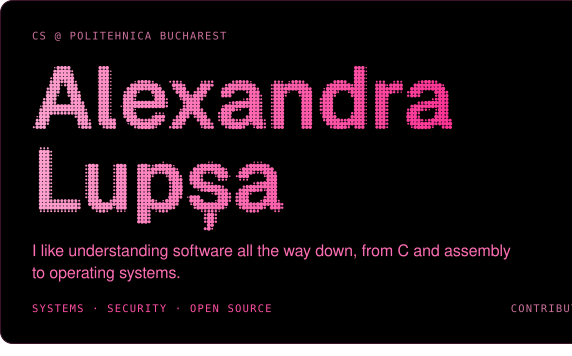<a href="https://lupsalexandra33.github.io">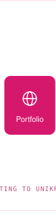</a><a href="https://www.linkedin.com/in/lupsalexandra33/">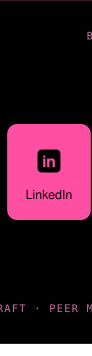</a><a href="mailto:alexandralupsa5@gmail.com">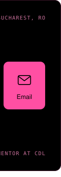</a> 
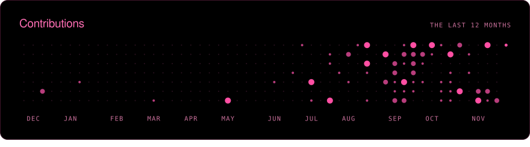 
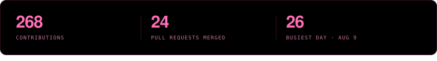 
<a href="https://github.com/unikraft/lib-ruby/pull/4">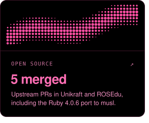</a>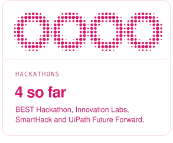<a href="https://github.com/elisaarghir/Zattify">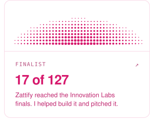</a> 
 
<a href="https://github.com/unikraft/lib-ruby/pull/4">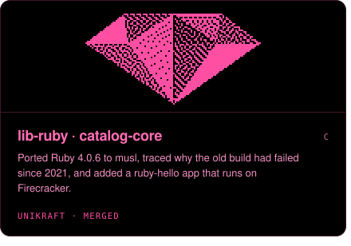</a><a href="https://github.com/lupsalexandra33/container-vuln-scanner">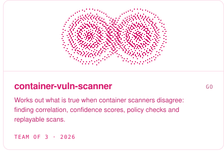</a> 
<a href="https://github.com/Andrei9383/smarthack">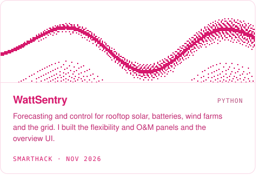</a>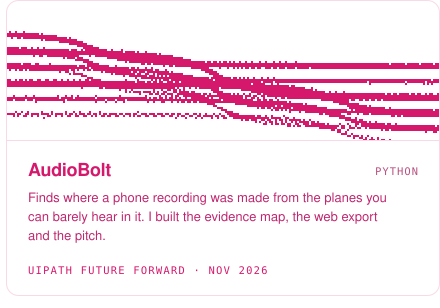 
 
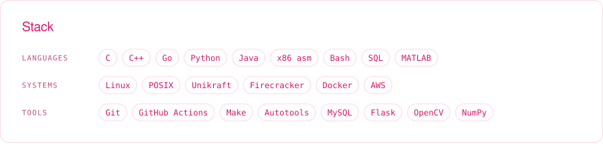 
<a href="https://github.com/unikraft">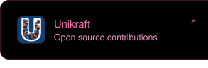</a><a href="https://github.com/rosedu">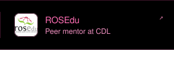</a><a href="https://github.com/Innovation-Labs-Romania">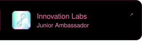</a> 
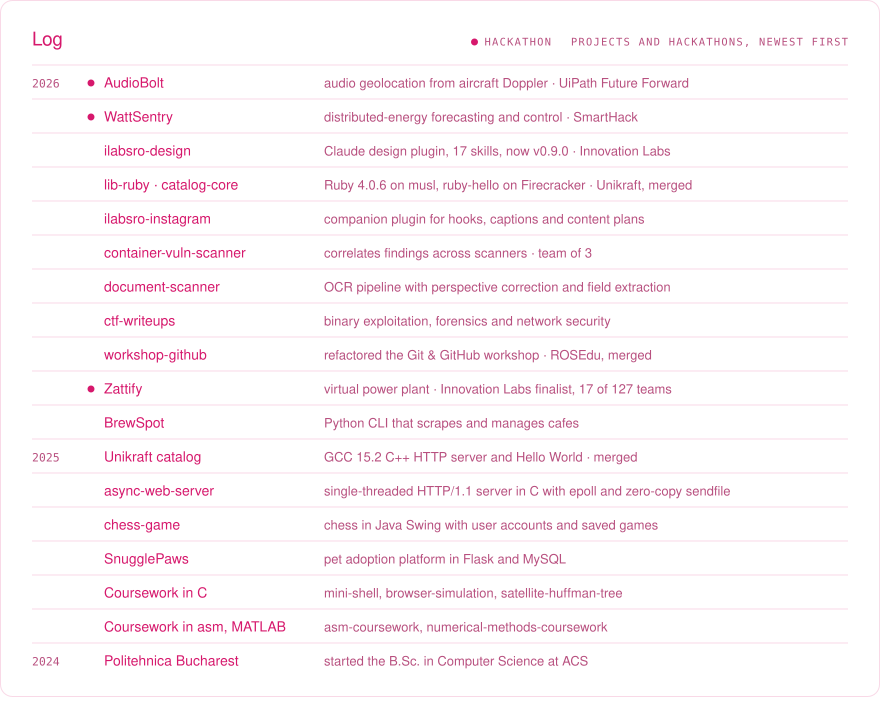

